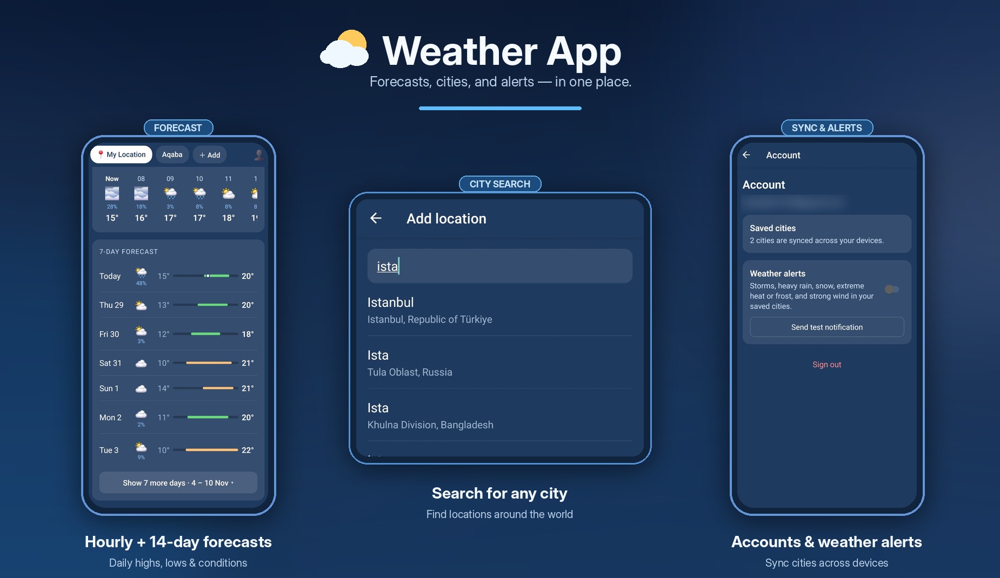
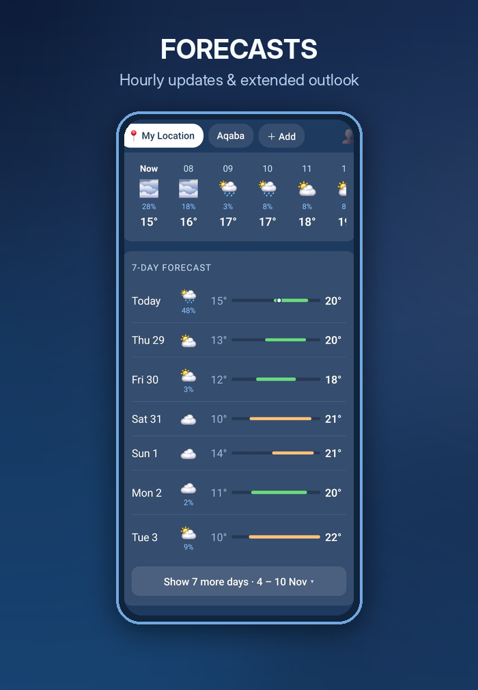
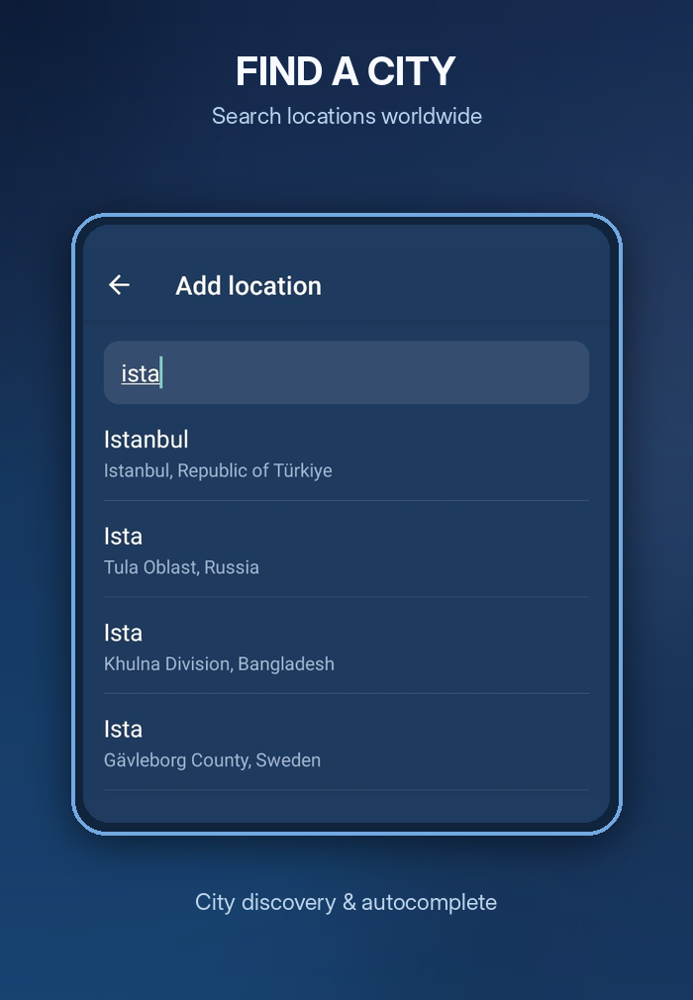
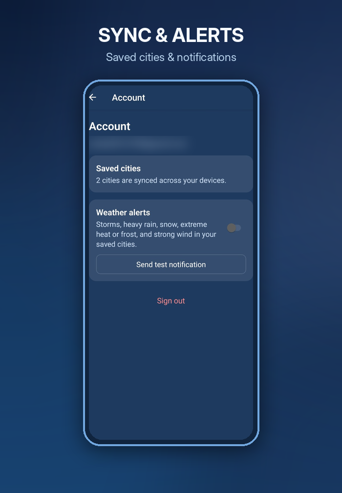

# 🌦️ Weather App

**A React Native weather app for Android, built with Expo SDK 58 and TypeScript.**

Get forecasts for your current location or any city you save, explore hourly and extended daily weather, and stay informed with optional push notifications. Sign in to keep saved cities synchronized across devices.

**Built with:** React Native · Expo SDK 58 · TypeScript · Open-Meteo · Firebase

<p align="center">
  
</p>

## ✨ Features

### 🌤️ Weather forecasts

- **My Location:** Use the device's GPS to view local weather.
- **Current conditions:** Temperature, feels-like temperature, humidity, wind, and today's high and low.
- **Next 24 hours:** Horizontally scrollable hourly forecast.
- **7–14 day outlook:** Seven-day forecast with a **Show 7 more days** option, including minimum–maximum temperature bars.
- **Pull to refresh:** Refresh weather information on each city's page.

### 🌍 Cities and accounts

- **City search:** Find and add cities by name; each saved city gets its own tab.
- **Offline-friendly city list:** Saved cities are retained on the device when signed out.
- **Optional accounts:** Sign up or sign in with email and password using Firebase Authentication.
- **Live synchronization:** Signed-in users' saved cities synchronize across devices through Cloud Firestore, with a local copy retained on the phone.

### 🔔 Notifications

- **Weather alerts:** Optional push notifications for storms, heavy rain, snow, extreme heat or frost, and strong winds in saved cities.
- **Scheduled checks:** A Cloud Function checks forecasts for relevant conditions every three hours and sends new alerts through Firebase Cloud Messaging (FCM).
- **Deep linking:** Tapping a weather alert opens the affected city's tab.
- **Alert controls:** Enable or disable alerts and send a test notification.
- **Firebase campaigns:** Messages broadcast through the Firebase console can reach app installations.

## 📱 Screenshots

<table>
  <tr>
    <td width="33%" align="center"></td>
    <td width="33%" align="center"></td>
    <td width="33%" align="center"></td>
  </tr>
  <tr>
    <td align="center"><b>Weather Forecast</b></td>
    <td align="center"><b>City Search</b></td>
    <td align="center"><b>Account & Alerts</b></td>
  </tr>
</table>

## 🛠️ Tech Stack

| Technology | Role |
| --- | --- |
| **React Native** | Android application interface |
| **Expo SDK 58** | Application development and native tooling |
| **TypeScript** | Typed application logic and data models |
| **Open-Meteo** | Forecast data |
| **Device location (GPS)** | Weather for the current location |
| **Firebase Authentication** | Email/password accounts and authentication state |
| **Cloud Firestore** | Cloud storage and live synchronization of saved cities |
| **Firebase Cloud Messaging (FCM)** | Weather alerts and campaign notifications |
| **Firebase Cloud Functions** | Scheduled server-side weather alert checks |
| **Local device storage** | Saved cities and a local copy of synced data |

## ⚙️ How It Works

### 1. Forecast data

1. A weather screen calls `useForecast`.
2. The hook uses `fetchForecast` to request weather data from **Open-Meteo**.
3. The API response is converted into the application's `Forecast` type.
4. UI components render the current conditions, hourly forecast, and daily outlook.

```text
Weather Screen → useForecast → fetchForecast → Open-Meteo
                                            ↓
                             Normalized Forecast data
                                            ↓
                                       UI Components
```

### 2. Authentication

1. The authentication service under `services/auth` communicates with **Firebase Authentication**.
2. `onAuthStateChanged` observes sign-in and sign-out events.
3. `AuthContext` updates the authentication state.
4. Dependent screens re-render with the current user's information.

### 3. Saved city synchronization

**Signed out:** Saved cities are stored locally on the phone.

**Signed in:** The city list is stored in Firestore at `users/{uid}`. A live Firestore listener keeps each signed-in device updated, while a local copy is also retained on the phone.

```text
Signed out → Device storage

Signed in → Firestore: users/{uid}
                  ↕ live listener
             Each signed-in device
                  ↕
             Local device copy
```

### 4. Weather alerts

1. The device receives an FCM registration token, saved under `users/{uid}/devices`.
2. Every **3 hours**, a scheduled Cloud Function checks forecast conditions for saved cities.
3. The function delivers new qualifying alerts through FCM.
4. Tapping a weather alert navigates to that city's tab.

Campaign notifications can also be sent from the Firebase console to app installations.

### 5. Firestore security

`firestore.rules` restricts each user to reading and writing only their own Firestore data. Authentication is required to access cloud-synced account data.

> **Configuration note:** This README intentionally does not list environment-variable names or deployment commands because those depend on the project's actual configuration. Keep Firebase service-account credentials and other secrets out of the repository.

## 🔐 Privacy and Permissions

- Location access is used to provide the **My Location** forecast.
- Weather alerts require notification permissions and a registered device token.
- Firebase Authentication identifies users for synchronized city lists.
- Firestore security rules are designed to isolate each user's stored data.

## 👨‍💻 Author

Developed by [Rashed Abuodeh](https://github.com/rashedabuodeh).
